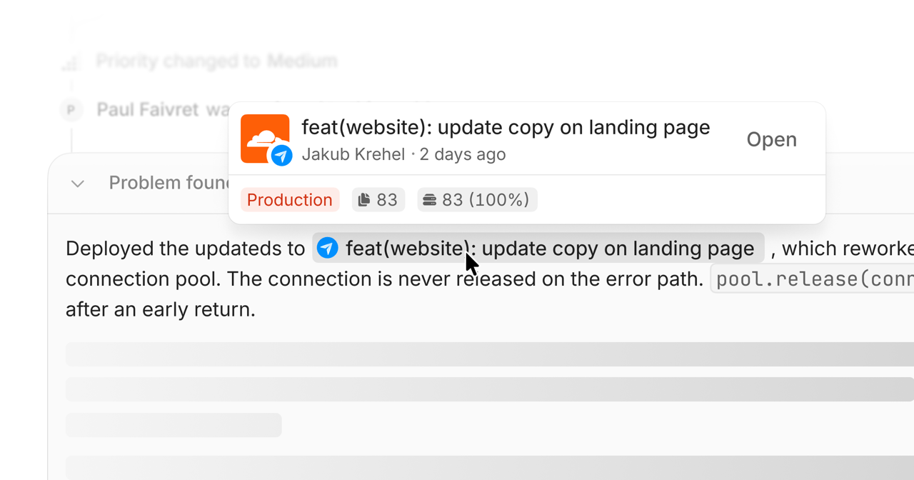
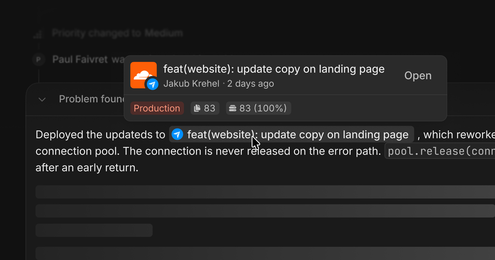

<Frame>
  
  
</Frame>

Connect Cloudflare to track Worker versions and associate deployments with releases.

## Connect Cloudflare

Open [Cloudflare settings](https://interfere.com/~/*/settings/connections/cloudflare) and authorize the connection. On the **Destinations** tab, find the Worker and choose **Link to App** to link it to its Interfere app.

If your account can access multiple Cloudflare accounts, the integration connects the first accessible account. Check that the expected Workers appear before linking an app.

## Tag deployments with the commit

Pass the source commit SHA as the deployment tag:

```bash
wrangler deploy --tag "$GITHUB_SHA"
```

GitHub Actions provides `GITHUB_SHA`. In another CI system, supply its commit SHA instead.

Use a raw commit SHA of 7 to 40 hexadecimal characters. Tags such as `release-abc123` and `v1.2.3` do not identify a source commit for Interfere.

## Verify the release

After deploying, open the app's releases and check that the Worker version links to the expected commit. Untagged deployments still appear as releases, but have no source commit link.

The deployment connection tracks versions. Install an SDK in your app separately to capture application telemetry.

## Permissions and reconnection

Interfere requests `memberships.read` to list accessible accounts and `workers-scripts.read` to list Workers. `offline_access` keeps the connection authenticated between visits.

If access expires or is revoked, reconnect in [Connections](https://interfere.com/~/*/settings/connections).
