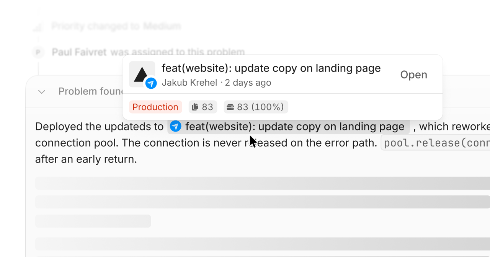
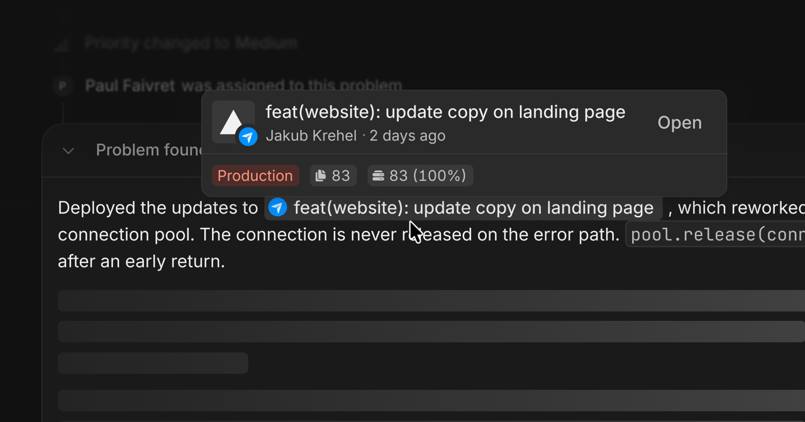

<Frame>
  
  
</Frame>

Connect Vercel to associate deployments with Interfere releases. You can also configure drains to send server traces and logs.

## Connect and map projects

Open [Vercel settings](https://interfere.com/~/*/settings/integrations/vercel) and complete Vercel's authorization flow. Choose the account and projects to include.

Open **Configuration** and link each Interfere surface to its Vercel project. A connection belongs to one Vercel account or team; add another connection for another account.

## Verify a deployment

Deploy a code change and open the surface's releases. Check that the deployment points to the expected commit. Interfere follows build states including building, ready, errored, and canceled.

Redeploying the same commit uses the same release identity. The commit identifies the code version.

## Trace and log drains

Open **Drains** after mapping the project and surface. Enable a trace drain, log drain, or both. Each drain shows whether it is live or paused, and you can pause, resume, or delete it.

The Next.js SDK selects drain mode automatically; there is nothing to configure. When a trace or log drain is enabled for the surface, the build reads it from the surface configuration and skips the matching SDK exporter. A surface without a trace drain keeps the SDK exporter, so traces are never dropped. If the build cannot load the surface configuration, server traces default to drain on Vercel.

To export directly instead, pass `serverTracing: "full"` to `register()`. On Vercel the SDK logs a warning and caps each export at 2 seconds. See [OpenTelemetry](/sdk/opentelemetry#server-telemetry).

## Permissions

Interfere reads the projects you authorize and receives deployment events. Enabling a drain creates the corresponding drain configuration in Vercel.
