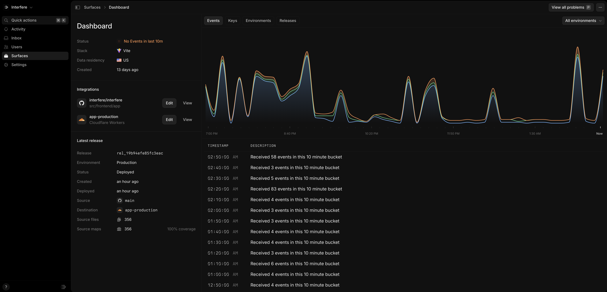

An app is something you monitor, such as a web frontend or backend service. Give each separately deployed frontend or service its own app in Interfere. The API and Terraform call an app a surface.

## Create an app

Follow [Create an app](/product/apps/create) to name your app, choose its framework, and connect the SDK.

## Check incoming events

Open the app in [Apps](https://interfere.com/~/*/apps) and inspect its event chart on the **Overview** tab. New apps wait for their first event; after capture starts, the chart shows event volume over time.

<Frame caption="The event chart shows incoming telemetry for the selected environment.">
  

    

      
    

  

</Frame>

## Keys

The public key identifies the app receiving telemetry and can ship in browser code. The secret API key registers releases and uploads source maps from your build pipeline. Keep it in your server or CI environment.

Open the app's key settings to manage these credentials. See [API keys](/integrations/api-keys) for workspace automation keys.

## Environments and releases

An environment labels traffic from a deployment, such as `production` or `staging`. Use environment filters when reviewing problems so you can focus on the deployment you are investigating.

A release identifies a version of your code. Open the app's **Releases** tab to review its environments and deployment times. See [Releases](/product/apps/releases) for how releases and source maps help you investigate a problem.

Use [Terraform](/integrations/terraform) to manage app names and framework types in infrastructure configuration.
