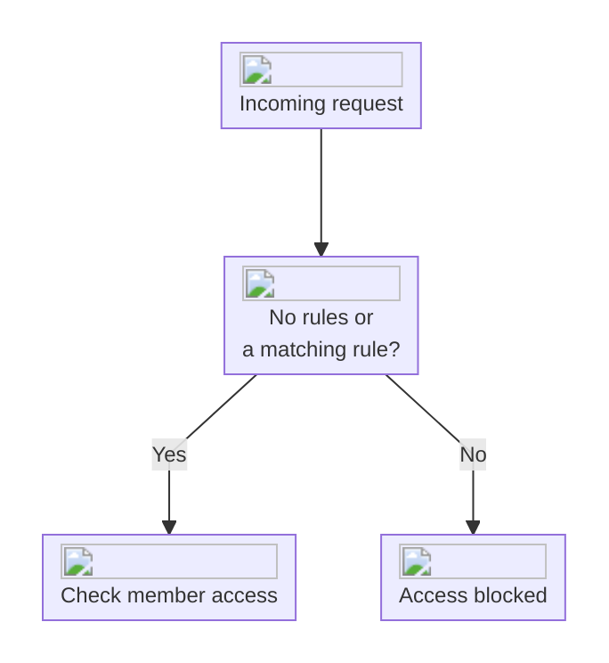

import { EnterpriseBadge } from "/components/EnterpriseBadge.tsx";

## Allow trusted networks <EnterpriseBadge />

Enterprise workspaces can restrict dashboard and API access in [Security settings](https://interfere.com/~/*/settings/security). Changing rules requires workspace authentication management permission.

Select **Add a network**, enter an IPv4 or IPv6 address, CIDR range, or ASN, and add a description. You can configure up to 100 rules.

With no rules, authenticated members can access the workspace from any network. Once rules exist, connections must match an allowed network.

If a connection is blocked, connect through an allowed company network or VPN. Ask an administrator to review the rules if your expected network is missing. Members still need workspace permissions after passing the network check.

## How rules affect access

<Warning>
  If you don't manage the autonomous system (AS) associated with your IP addresses, use a specific
  IP address or CIDR range where possible. Allowing the entire ASN can also allow other customers of
  the same network operator, such as other users of a VPN service.
</Warning>
