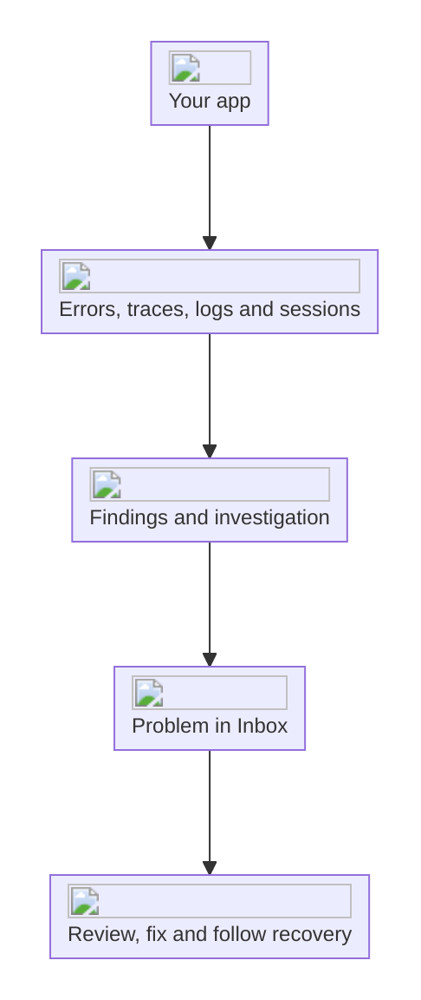

Interfere collects errors, traces, logs, and session replays from your apps and uses them to investigate problems. A problem brings the investigation and its supporting evidence into one place, alongside the users, companies, and releases involved.

## From events to a problem

An error describes one failure. A trace shows the work around it, and a session replay can show what someone did before the failure. Interfere groups related occurrences into findings and uses that evidence to investigate the underlying problem.

For example, several customers might hit the same exception while choosing store pickup at checkout. Those occurrences can belong to one problem. The investigation can connect the exception to a release, inspect the affected code through your GitHub integration, and explain why that checkout path fails.

The available evidence determines how much the investigation can establish. Read the explanation alongside its linked traces and code before deciding on a fix.

## What you see in a problem

- **Timeline** contains the investigation, updates, and your team's discussion.
- **Findings** contains the recorded evidence. Open an occurrence to inspect its trace and stack frames.
- **Sessions** connects the problem to affected sessions and their replays.

Start with the [Inbox](/product/inbox) to find problems that need attention. The [investigation walkthrough](/product/problems) follows a checkout failure through its evidence and recovery.

## Understand the impact

[Users](/product/users) are the people using your monitored app. [Companies](/product/companies) represent customer accounts and group their users. Identifying users in your app gives your team a way to connect a reported failure to the customer's sessions and problems.

A **surface** is an app you monitor, such as a storefront or its backend API. Each surface has its own keys and releases. Your **workspace** holds your team's surfaces, integrations, members, and settings. Use environments to distinguish staging from production within a surface.

## Follow the fix

Assign a problem to a teammate, set its priority, and add context in the timeline. After deploying a fix, inspect new occurrences and the releases they came from. Interfere follows recovery and resolution as it observes events; a resolved problem can reopen as a regression.

<CardGroup cols={2}>
  <Card title="Connect your first app" icon="/icons/ui/rocket.svg" href="/quickstart">
    Set up a surface, install its SDK, and verify incoming events.
  </Card>
  <Card title="Investigate a problem" icon="/icons/ui/bug.svg" href="/product/problems">
    Read the investigation and check the evidence behind it.
  </Card>
</CardGroup>
