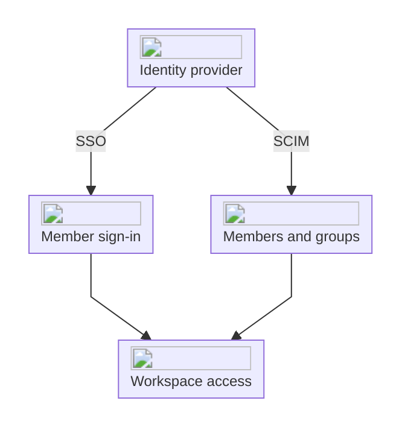

import { EnterpriseBadge } from "/components/EnterpriseBadge.tsx";

Manage who can sign in, how teammates join, and which networks can reach your workspace in [Settings → Security](https://interfere.com/~/*/settings/security).

## Choose the control you need

| Task                                 | Setting                                                    |
| ------------------------------------ | ---------------------------------------------------------- |
| Choose permitted sign-in methods     | [Identity providers](/product/security/identity-providers) |
| Use your company's identity provider | [Single sign-on](/product/security/sso)                    |
| Synchronize members and groups       | [Directory sync](/product/security/scim)                   |
| Invite teammates by email domain     | [Verified domains](/product/workspace-domains)             |
| Restrict access by IP, CIDR, or ASN  | [Network access](/product/network-access)                  |

## Authentication and provisioning

SSO lets members sign in through your identity provider, while directory sync keeps their workspace membership and groups aligned with it. You can configure either or both, depending on how your team manages access.

## Sign in

Choose supported providers in [Sign-in methods](/product/security/identity-providers). Members can manage their passkeys in [Profile settings](https://interfere.com/~/*/settings/profile).

## Single sign-on <EnterpriseBadge />

Connect your company's identity provider and manage its active connection in Security. Follow [Single sign-on](/product/security/sso) for setup and sign-in behavior.

## Roles and permissions

Assign Owner, Admin, or Member access in [Members and roles](/product/members). Review administrative changes in the [Audit log](/product/audit-log).

## Network access <EnterpriseBadge />

Allow only approved networks to reach the dashboard and API. Follow [Network access](/product/network-access) for IP, CIDR, and ASN rules.

## Infrastructure

[Infrastructure](/product/infrastructure) describes Interfere-owned address space for your firewall configuration. These addresses are separate from the Enterprise allowlist that controls access to your workspace.

For reports and certifications, visit [Interfere security](https://interfere.com/security).
