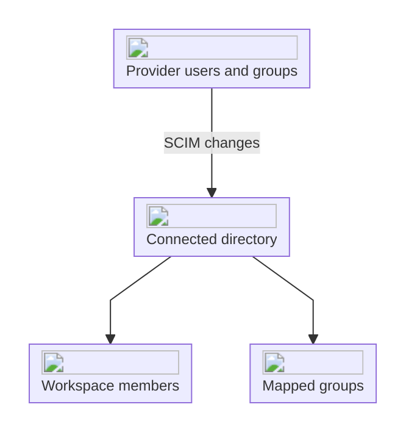

import { EnterpriseBadge } from "/components/EnterpriseBadge.tsx";

## Synchronize your directory <EnterpriseBadge />

Directory sync connects your provider's users and groups to workspace membership. Use [SSO](/product/security/sso) for authentication and directory sync for provisioning and deprovisioning.

## Set up a directory

Contact [support@interfere.com](mailto:support@interfere.com) with your workspace and provider to arrange the connection. Once configured, open [Settings → Security → Directory sync](https://interfere.com/~/*/settings/security).

With permission to manage workspace authentication, you can enable or disable each directory here and see how many groups an enabled directory maps to the workspace.

## Check provisioning

After setup, test a member assignment through the provider and check the result in [Team](/product/members). Confirm the expected workspace role before rolling the directory out to everyone.

Review membership changes in the [Audit log](/product/audit-log). If a member or group is missing, check that the directory is enabled and that the provider assigns it to the Interfere application.

## Provider-managed domains

Domains labeled **Enterprise SSO** in Security get their enrollment rules from your identity provider. See [Verified domains](/product/workspace-domains) for how these differ from domains you manage directly.
