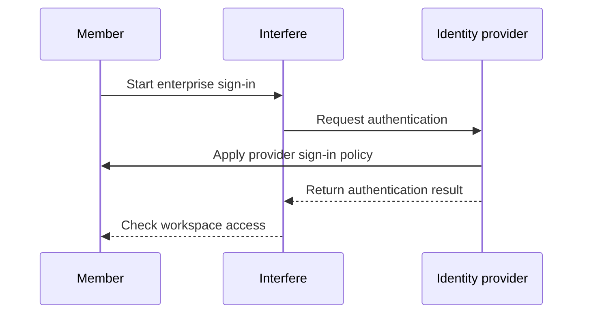

import { EnterpriseBadge } from "/components/EnterpriseBadge.tsx";

## Connect your provider <EnterpriseBadge />

<Info>
  Single sign-on requires Enterprise and an identity-provider connection configured for your
  workspace.
</Info>

Contact [support@interfere.com](mailto:support@interfere.com) with your workspace, identity provider, and company email domain to arrange setup. Interfere supports enterprise SAML and OIDC connections. Keep provider credentials and client secrets out of email; support will coordinate any required configuration securely.

## Manage a connection

Open [Settings → Security](https://interfere.com/~/*/settings/security). The **Single sign-on** row shows configured connections and their active switches. Changing a connection requires permission to manage workspace authentication.

After activating the connection, test sign-in with an intended member account. Check that the member reaches the correct workspace and has the expected role in [Team](/product/members).

## Understand the sign-in flow

<Note>
  Activating SSO does not automatically turn off email codes or passkeys. Review [Identity
  providers](/product/security/identity-providers) before setting your team's sign-in policy.
</Note>

## Provision members

SSO handles sign-in. Use [Directory sync](/product/security/scim) when you also need provider-managed membership and groups. Domains managed by your provider show **Enterprise SSO** in the [Domains](/product/workspace-domains) section.
