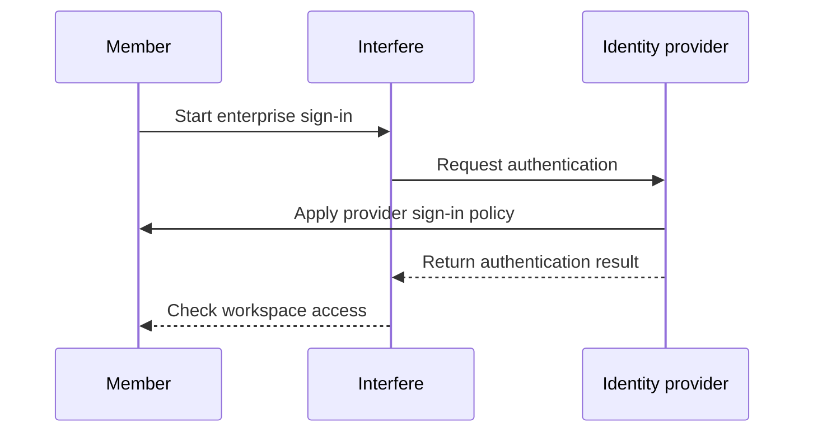

import { EnterpriseBadge } from "/components/EnterpriseBadge.tsx";

## Connect your provider <EnterpriseBadge />

To connect a SAML or OIDC provider, contact [support@interfere.com](mailto:support@interfere.com) with your workspace, provider, and company email domain. We'll coordinate the configuration with you, including a secure way to exchange any credentials.

## Manage a connection

You can activate or deactivate configured connections in the **Single sign-on** row of [Settings → Security](https://interfere.com/~/*/settings/security), provided you have permission to manage workspace authentication.

After activating a connection, sign in with a member account to check that it reaches the correct workspace with the expected role in [Team](/product/members).

## Understand the sign-in flow

<Note>
  Activating SSO does not automatically turn off email codes or passkeys. Review [Identity
  providers](/product/security/identity-providers) before setting your team's sign-in policy.
</Note>

## Provision members

To have your provider manage membership and groups as well as sign-in, set up [Directory sync](/product/security/scim). Domains managed by your provider show **Enterprise SSO** in the [Domains](/product/workspace-domains) section.
