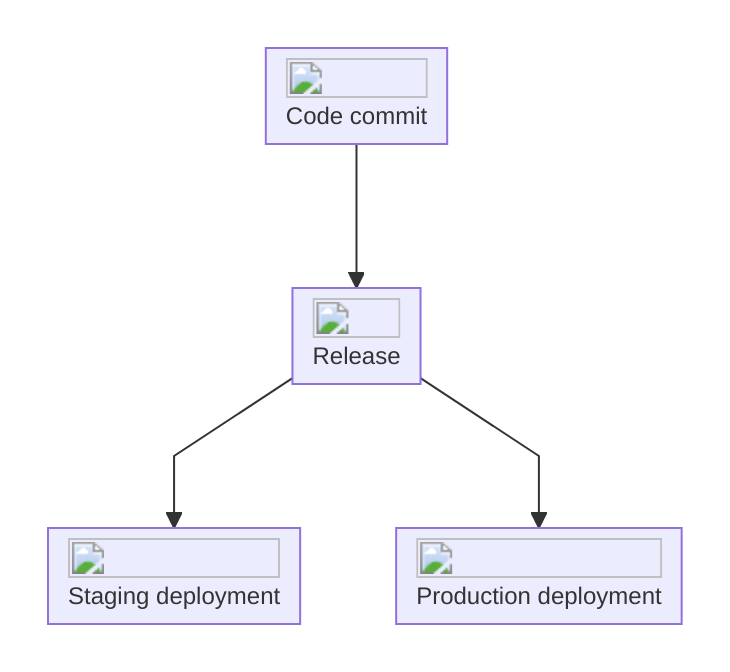

A release identifies a version of a surface's code. Use releases to check which version was deployed when a problem appeared, and to follow what happened after a fix.

## Review a surface's releases

Open an app in [Surfaces](https://interfere.com/~/*/surfaces), then select **Releases**. The list shows the release, environment, creation time, deployment time when available, and links to its source or deployment provider.

Search the list or filter by environment to narrow it to the deployment you are investigating. If no releases match, clear the search and filters before checking whether your build has registered a release.

## Understand environments and deployments

An environment distinguishes traffic such as production and staging. A release identifies the code version; a deployment records when that code runs in an environment. Deploying the same commit again does not create a new code version.

When checking a reported failure, compare its time and environment with the release's deployment time. A nearby deployment is context for the investigation, not proof that it caused the failure.

## Read original code in a stack trace

Source maps connect compiled JavaScript in a stack trace to the original source files and lines. With the matching maps, a failure in a bundled file can point back to the TypeScript or application code your team maintains.

Open a problem from [Inbox](/product/inbox) and inspect its [trace and stack frames](/product/problems#3-open-the-failing-trace). If frames still show compiled code, ask the person maintaining the build to check the source-map upload for that release.

## Set up release reporting

Release registration and source-map uploads are configured in your app's build. The [SDK release and source-map guide](/sdk/releases) covers framework plugins, upload failures, and custom build pipelines.
