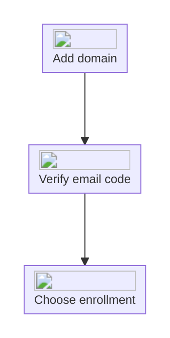

import { EnterpriseBadge } from "/components/EnterpriseBadge.tsx";

## Verify a domain <EnterpriseBadge />

Open [Settings → Security → Domains](https://interfere.com/~/*/settings/security). Use your team's email domain, such as `acme.com`, rather than the address your monitored app runs on. Free email-provider domains and IP addresses are not accepted.

<Steps>
  <Step title="Add your company domain">
    Select **Add a domain** and enter the domain. Managing domains requires permission to manage
    workspace domains.
  </Step>
  <Step title="Verify an email at that domain">
    Select **Verify domain**, enter an email address at the domain, and select **Send code**. Enter
    the code sent to that mailbox.
  </Step>
  <Step title="Choose how teammates join">
    Once the domain is verified, select its enrollment mode from the domain row.
  </Step>
</Steps>

## Enrollment modes

| Mode                    | What happens                                                                   |
| ----------------------- | ------------------------------------------------------------------------------ |
| No automatic enrollment | Invite teammates manually.                                                     |
| Automatic invitations   | People with a verified email at the domain receive an invitation.              |
| Automatic suggestions   | People with a verified email at the domain see a suggestion to request access. |

Automatic enrollment options remain unavailable until verification succeeds. Removing a domain stops its automatic invitations and access suggestions.

## Provider-managed domains

For a domain labeled **Enterprise SSO**, manage enrollment through your identity provider rather than the domain menu. See [SSO](/product/security/sso) and [Directory sync](/product/security/scim) for the connection's setup.

<Note>
  Your workspace domain describes your own team. [Companies](/product/companies) describe the
  customer accounts using your monitored app.
</Note>
